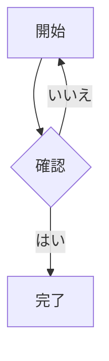

# ViMarkdown

**Vimスタイルのキー操作で書き、整形されたMarkdownで読む、macOS・Windows向けのノートアプリです。**

ノート・ページ・本文を見渡せる3ペイン構成で、メモ、議事録、技術ノートなどを整理できます。ノーマル／ビジュアルモードではMarkdownの記号を隠したリッチ表示、挿入モードではシンタックスハイライト付きの原文表示に切り替わります。読むときの見やすさと、原文を直接編集できる操作性を両立することを目指しています。

本文と貼り付け画像はローカルのSQLiteデータベースに保存します。アカウント登録やクラウド接続は不要で、通常のノート編集はオフラインで利用できます。C# / .NET 10 / Avaloniaで開発している、開発・検証中のアプリです。Vimの全機能や完全互換を提供するものではありません。対応範囲は[操作](#操作)と[制限と検証状況](#制限と検証状況)を参照してください。

## 主な特徴

- **読む表示と書く表示を切り替え** — 見出し、強調、リスト、引用、表、画像などを整形表示し、`i` で原文を編集、`Esc` でリッチ表示に戻れます。同じ本文を共有するため、表示切り替えでMarkdownを書き換えません。
- **Vimスタイルの編集** — `hjkl`、単語・段落移動、削除・コピー・貼り付け、テキストオブジェクト、文字・行・矩形選択、検索・置換に対応します。日本語IMEでの入力や、絵文字・結合文字を考慮した移動にも対応しています。
- **ノートとページで整理** — 階層のないノートにページをまとめ、ページをノート間で移動できます。自然順・更新日順の並べ替えと、今日・今週・今月などの期間絞り込みを使えます。
- **ページをまたいで検索** — 表示中のページ、選択中のノート、全てのノートから検索し、結果から該当行へ移動できます。
- **自動保存とローカル保存** — 入力後500msで本文を保存し、最後に開いたページを次回起動時に復元します。貼り付け画像もDB内で保持するため、元の画像ファイルに依存しません。
- **共有しやすい形式へ出力** — ページ単位・ノート単位でMarkdownまたはDOCXへ出力できます。Markdownは画像を添付フォルダへ、DOCXは画像をファイル内へまとめます。
- **Mermaidの図を表示** — フローチャートなどをコードで記述し、リッチ表示や出力に利用できます。この機能には別途Node.js・Mermaid CLI・Chromeの準備が必要です。

## 目次

- [利用を始める](#利用を始める)
- [最初のページを書く](#最初のページを書く)
- [ワークスペース](#ワークスペース)
- [ツールバー検索](#ツールバー検索)
- [操作・キーマップ](#操作)
- [表・画像](#表画像)
- [Markdown出力](#markdown出力) / [DOCX出力](#docx出力)
- [フローチャート（Mermaid）](#フローチャートmermaid)
- [データの保存とバックアップ](#データの保存とバックアップ)
- [制限と検証状況](#制限と検証状況)
- [開発・検証](#開発検証)

## 利用を始める

### 配布パッケージから起動する

作成済みの自己完結型ZIPを使う場合、利用者の環境に.NETをインストールする必要はありません。OSとCPUに合うパッケージを選んでください。

GitHubでの配布先は `https://github.com/nokura-dev/ViMarkdown` です。公開時はルート直下の `macos/`・`windows/` にZIPを配置します。各パッケージの検証状況は[公開パッケージの検証状況](#公開パッケージの検証状況)を参照してください。GitHub上で対象のZIPを開き、ダウンロードして展開してください。

| 環境 | 公開パッケージの配置先 |
|---|---|
| Apple Silicon搭載Mac | `macos/ViMarkdown-osx-arm64.zip` |
| Windows（x64） | `windows/ViMarkdown-win-x64.zip` |

**macOS:** ZIPを展開し、`ViMarkdown.app` をApplicationsフォルダへコピーして起動します。

**Windows:** ZIPを展開し、`Install.ps1` をPowerShellで実行すると、ユーザーの `LocalAppData/Programs/ViMarkdown` にコピーしてスタートメニューへ登録します。展開先の `publish/ViMarkdown.exe` から直接起動することもできます。

現在のパッケージはmacOSのDeveloper ID署名・公証、Windowsのコード署名を行っていません。OSによって起動時に警告や実行制限が表示される場合があります。パッケージの作成方法は[配布パッケージ](#配布パッケージ)を参照してください。

### ソースから起動する

.NET 10 SDKをインストールし、リポジトリ直下から実行します。

```sh
dotnet restore src/ViMarkdown --packages .nuget/packages
dotnet run --project src/ViMarkdown --no-restore
```

Windows・macOS共通のコマンドです。初回の復元にはNuGetへの接続が必要です。Mermaidを使わない場合、Node.jsやChromeの準備は不要です。

## 最初のページを書く

1. ノート一覧の作成ボタン、または `Ctrl+Shift+n` でノートを作成します。ノートを作らず「未分類」に書き始めることもできます。
2. ページ一覧の作成ボタン、または `Ctrl+n` でページを作成します。現在日時を名前と本文の先頭行に設定し、挿入モードで入力を始められます。
3. 本文にMarkdownを入力します。例えば、`# 見出し`、`- 箇条書き`、`**太字**` を書いてみてください。
4. `Esc` でノーマルモードへ戻ると、本文を整形表示します。再び編集するには `i`、行末から追記するには `A` を押します。
5. ページ名を変えるにはページを選び `F2`、別ノートへ移すには `Ctrl+m` を使います。本文は自動保存され、保存状態は編集領域の下部に表示されます。

`Ctrl` はmacOSでもControlキーです。画像・テキストの貼り付けには、挿入モードでmacOSの `Cmd+v` も使えます。モードは画面下部で確認でき、上部のボタンからも切り替えられます。

Vim操作に不慣れな場合も、挿入モードでの入力とマウスによるページ選択から始められます。`Esc` の後に文字が入力されなくなった場合は、`i` で挿入モードへ戻ってください。IME変換中の `Esc` は、まず未確定入力を取り消すために使われます。

## ワークスペース

ノートでページを整理し、一覧から選んだページを編集します。画面は3つのペインと、左端のタイムラインで構成されています。

### 画面の構成

- **ノート一覧**：ノートを作成・名前変更・削除します。ノートは階層を持たない一覧で、どのノートにも属さないページは「未分類」に表示します。
- **ページ一覧**：選択中のノートにあるページを表示します。ページの作成・名前変更・削除のほか、別ノートへの移動もできます。
- **編集画面**：選択したページの本文を表示・編集します。下部には編集モードや保存状態を表示します。
- **タイムライン**：更新期間による絞り込みと、ごみ箱を利用できます。

白い編集領域、薄いグレーの一覧とツールバー、淡い青の選択表示は、VSCodeのLight Plusを参考にしています。

### ペインの幅を調整する

- ノート一覧とページ一覧、ページ一覧と編集画面の境界をドラッグすると、幅を調整できます。
- 境界をダブルクリックすると、左側のペインを初期幅（ノート160px、ページ310px）に戻します。
- 各ペインにはツールバーや並べ替えの選択欄が収まる最小幅があります。左端のタイムラインは固定幅です。

### 一覧を並べ替える

ノートは「ノート2」「ノート10」のように、名前に含まれる数字を考慮した自然順で並びます。「未分類」は常に先頭です。

ページは、操作ボタン右側のプルダウンから並べ方を選べます。選んだ設定は再起動後も保持します。

- **名称順**：ノートと同じ自然順で表示します。
- **更新日(新しい順)**：最近作成・編集したページから表示します。
- **更新日(古い順)**：更新の古いページから表示します。

更新日時は、ページの作成・本文の保存・名前変更で記録します。ノート間で移動しても変わりません。同じ日時なら名称の自然順、同じ名称ならID順で並びます。旧形式のDBなどで更新日時が不明なページは、新しい順では末尾、古い順では先頭に表示します。

### 自動保存と再開

本文は次のタイミングで自動保存します。

- 最後の入力から500ms後
- 別のページへ切り替えるとき
- アプリを終了するとき

保存に失敗した場合は、ページ切り替え・終了を止めて本文を保持します。保存状態は編集画面の下部で確認できます。

正常終了後は、次回起動時に最後に開いたページと本文を復元します。Undo履歴はページを開き直すとリセットされます。また、強制終了時には最後の500ms以内の編集が保存されていない可能性があります。

保存先やバックアップ方法は[データの保存とバックアップ](#データの保存とバックアップ)を参照してください。

### 期間で絞り込む

左端のタイムラインで、ページの更新日時をもとに一覧を絞り込めます。

- **全て**：期間で絞り込まずに表示します。
- **今日・今週・先週**：日・週単位で探します。
- **今月・先月・先々月**：月単位で探します。

探しているページが見当たらない場合は「全て」に戻してください。ページを作成した場合も、期間は「全て」に戻ります。

### 削除とごみ箱

- **ページを削除**すると、そのページをごみ箱へ移します。
- **ノートを削除**すると、ノート内のページもごみ箱へ移します。ノート自体は削除され、復元できません。

ページを復元するには、左端の下部にあるごみ箱を開きます。対象を選ぶと削除日と本文を確認でき、「復元」でページ一覧へ戻せます。削除済みノートに属していたページは「未分類」へ戻ります。

削除から30日経過したページは、アプリ起動時に完全削除されます。ごみ箱は長期保管用ではありません。

旧形式のDBにある子フォルダは、独立したノートへ自動移行します。ページの所属・本文・画像は保持します。

## ツールバー検索

編集画面のツールバー右端に、検索範囲・キーワード入力・虫眼鏡を一体化した検索ボックスがあります。「全てのノート」「選択中のノート」「表示中のページ」（初期値）から範囲を選び、Enterキーまたは虫眼鏡で検索します。大文字・小文字を区別しない文字列検索で、未保存の本文も対象にします。エディタ幅が狭い場合はツールバーを横スクロールできます。

「全てのノート」「選択中のノート」の検索実行後は、検索結果一覧へフォーカスを移して先頭カードを選択します。結果が0件の場合も一覧へ移動します。

「表示中のページ」では該当行へ直接スクロールし、一致語を黄色で強調してカーソルを一致語の先頭に置きます。同じキーワードで再検索すると次の一致箇所へ進み、末尾で先頭へ戻ります。

ノートを対象に検索するとワークスペース右端に結果ペインを表示します。カード上段は「ノート名 → ページ名　行番号」、下段は一致語を強調したMarkdown原文です。同じ行の複数一致は1枚のカードにまとめます。結果をダブルクリックすると該当ページ・行へ移動し、結果一覧とスクロール位置は保持します。結果ペインは右上の×で閉じます。期間で非表示になっていたページへ移動する場合はタイムラインを「全て」に戻します。

## 操作

ノーマル・ビジュアルモードでは、段落間の空白行を一定の余白として表示します。連続する空白行はまとめ、コードブロック内の空白行はそのまま保持します。原文の空白行は挿入モードで確認・編集できます。

フォーカスのあるペインは、ツールバーを除く内容領域を2pxの青枠で表示します。ペイン間移動はWindows・macOSともControlキーを使い、ツールバーは経由しません。ツールバーの操作ボタンはフォーカス対象から除外し、Tab／Shift+Tabでも移動しません（マウスによる操作は可能）。検索欄へはCtrl+Fで移動できます。キーワード欄のShift+Tabで検索範囲へ移動し、macOSは⌘+↓、WindowsはAlt+↓で候補を展開します。↑／↓で移動、Enterで確定、Escで閉じます。編集領域の上下キーは従来のカーソル移動を維持します。スクロールバーはスクロール中だけ表示し、操作終了から約0.65秒で隠れます。つまみのドラッグ中は表示を保ちます。

### キーマップの読み方

大文字・小文字は区別します。`Ctrl` はControlキーです。以下は現在実装している操作で、本文にフォーカスがあるときに使います。通常のコマンドはノーマルモード、選択操作はビジュアルモードで使用します。

### カーソル移動

| キー | 動作 |
|---|---|
| `h` / `←` | 1文字左へ。行頭からは前の表示行の末尾へ移動 |
| `l` / `→` | 1文字右へ。最終文字の後ろまで進み、さらに押すと次の表示行へ移動 |
| `j` / `↓`、`k` / `↑` | 下／上へ。画面上の折り返しを考慮し、横位置を維持 |
| `0` / `^` / `Home` | 表示内容の行頭へ移動。`0` と `^` は同じ動作 |
| `$` / `End` | 行の最終文字の後ろへ移動 |
| `w` / `b` / `e` | 次の単語先頭／前の単語先頭／単語末尾へ移動 |
| `W` / `B` / `E` | 空白区切りの単語で同様に移動 |
| `gg` / `G` | 先頭行／最終行の最初の非空白文字へ移動 |
| `数字gg` / `数字G` | 指定行へ移動。例：`10G` |
| `{` / `}` | 前／次の段落境界へ移動。文書端からも逆方向へ戻れる |

表示移動はMarkdownの非表示記号を飛ばし、絵文字・結合文字を1つの書記素として扱います。表内はセルの表示文字を基準に移動します。`$` と `h` / `l` の行末・行越え動作、および `^` と `0` の同一動作は、このアプリの仕様です。

### 挿入・編集・履歴

| キー | 動作 |
|---|---|
| `i` / `a` | 現在位置の前／後ろから挿入 |
| `I` / `A` | 行内の最初の非空白文字の前／行末から挿入 |
| `o` / `O` | 下／上に行を開いて挿入。字下げを継承 |
| `Esc` | ノーマルへ戻る、または入力途中のコマンドを解除。挿入モードでは直前の書記素へ移動（IME変換中は後述） |
| `x` / `s` | カーソル位置の文字を削除／削除して挿入 |
| `r文字` / `R` | 指定文字に置換／上書き入力 |
| `d移動` / `c移動` / `y移動` | 移動範囲を削除／変更して挿入／コピー。例：`dw`、`c0`、`y$` |
| `dd` / `cc` / `yy` / `Y` | 行を削除／変更／コピー／コピー |
| `D` / `C` / `S` | 行末まで削除／行末まで変更して挿入／行を変更して挿入 |
| `d$` | カーソル位置から行末まで削除。残った文字の後ろにカーソルを維持 |
| `p` / `P` | 後ろ／前へ貼り付け。行単位の内容は下／上の行へ貼り付け |
| `J` | 次の行と結合。選択中は選択行を結合 |
| `>移動` / `<移動` / `=移動` | 対象行の字下げ／解除／前行に合わせる |
| `>>` / `<<` / `==` | 現在行の字下げ／解除／前行に合わせる。字下げは4スペース |
| `u` / `Ctrl+r` | Undo／Redo |

`d$` の削除後の位置維持は `d$` に適用します。`D` を含む他の削除操作には従来のカーソル補正が適用されます。`I` は最初の非空白文字を基準とし、`0` と同じ動作の `^` とは異なります。

### 選択

| キー | 動作 |
|---|---|
| `v` / `V` / `Ctrl+v` | 文字／行／矩形選択を開始。同じ選択モードのキーで解除 |
| 移動キー | カーソルを移動して選択範囲を変更 |
| `o` / `O` | 操作する端を交換。矩形選択の `O` は左右の端を交換 |
| `gv` | 前回の選択を復元 |
| `d` / `x`、`c` / `s`、`y` | 選択範囲を削除／変更して挿入／コピー |
| `r文字` | 選択範囲の文字を置換 |
| `p` / `P` | 選択範囲を貼り付け内容で置換 |
| `>` / `<` / `=` | 選択行の字下げ／解除／前行に合わせる |
| 矩形選択中の `I` / `A` | 各行の選択範囲の前／後ろへまとめて挿入 |
| `Esc` | 選択を解除してノーマルへ戻る |

### テキストオブジェクト

`i対象` は内側、`a対象` は区切りや周囲も含む範囲です。`d`・`c`・`y`・`>`・`<`・`=` と組み合わせるか、選択中に使います。例：`diw`、`ci"`、`ya(`、`viw`。

| 対象キー | 指定する範囲 |
|---|---|
| `w` / `W` | 単語／空白区切りの単語。`aw`・`aW` は周囲の空白も含む |
| `p` | 段落。`ap` は段落末尾の改行も含む |
| `s` | 現状は `p` と同じ段落処理。文単位の判定は未実装 |
| `(` / `)` / `b` | 丸括弧。例：`di(` と `di)` は同じ動作 |
| `[` / `]` | 角括弧 |
| `{` / `}` / `B` | 波括弧 |
| `<` / `>` | 山括弧 |
| `"` / `'` / `` ` `` | 同じ行にある半角の引用符・バッククォート |

括弧は入れ子と回数指定に対応します。`(`・`)`・半角 `"` の単独キーに割り当てはありません。Vim標準の `(`・`)` による文単位移動、`"a` のような名前付きレジスタ指定は未実装です。曲がった引用符 `“`・`”`・`‘`・`’` にも割り当てはなく、テキストオブジェクトの区切りとしても未対応です。

### 検索・Exコマンド

| キー・コマンド | 動作 |
|---|---|
| `/検索語` / `?検索語` | 前方／後方検索 |
| `n` / `N` | 同じ方向／逆方向に検索を繰り返す |
| `*` / `#` | カーソル位置の単語を前方／後方検索 |
| `:数字` | 指定行へ移動 |
| `:w` / `:write` | 保存 |
| `:q` / `:quit` / `:q!` | ウィンドウを終了。自動保存の方針は維持 |
| `:wq` / `:x` | 保存に成功したら終了 |
| `:s/旧/新/` | 現在行の最初の一致を置換 |
| `:%s/旧/新/g` | 全行の全一致を置換 |
| `:2,5s/旧/新/g` | 指定行範囲で置換 |
| 選択中の `:s/旧/新/g` | `:'<,'>` が補われ、選択行範囲で置換 |
| `:s` | 前回の置換を現在行で再実行 |
| 入力中の `Enter` / `Esc` / `Backspace` | 確定／取り消し／最後の文字を削除 |

### 回数指定

移動や編集の前に数字を付けます。例：`3j`、`5x`、`2dd`、`2p`、`2$`。`2$` は次の原文行の末尾へ移動します。オペレータ前後の回数は乗算され、`2d3w` は6単語が対象です。`0` 単独は回数ではなく行頭移動です。

### マウス・ワークスペース

| 操作 | 動作 |
|---|---|
| 本文をクリック | リッチ表示上の原文位置へ移動 |
| `Ctrl+Shift+←` / `Ctrl+Shift+→` | 期間・ノート・ページ・編集・表示中の検索結果へフォーカスを移動（端では停止、前回位置へ復帰） |
| `↑` / `↓`（一覧） | 前後の項目を選択。期間は選択と絞り込みも即時に切り替え、検索結果はEnterで開く |
| `Ctrl+f` | 検索結果ペインの表示中はペインを閉じて編集へ復帰。それ以外は検索欄へフォーカス |
| `Ctrl+n` / `Ctrl+Shift+n` | ページ／ノートを作成 |
| `F2` / `Ctrl+F2` | ページ／ノートの名前を変更 |
| `Ctrl+m` | ページを別ノートへ移動 |
| 一覧にフォーカスして `Delete` | 対象のページ／ノートを削除 |
| 挿入中の `Ctrl+v` / `Cmd+v`（macOS） | クリップボードの画像・テキストを貼り付け |

上部のボタンでもモード変更、Undo、Redoができます。ボタンでモードを切り替える場合は原文のカーソル位置を維持します。
`d`、`c`、`y` は次の移動やテキストオブジェクトを待ちます。時間経過による単独 `d` の削除はありません。`Esc` で保留中のコマンドを取り消します。
`v` はアンカーとカーソルの両端を含め、絵文字・結合文字も書記素全体を選択します。矩形選択は原文の書記素列を基準とし、`d`・`c`・`y`・`p`・`I`・`A` に対応します。矩形への入力は `Esc` またはモード切り替え時に各行へ反映します。
`y` / `yy` はOSクリップボードへコピーし、`x` / `d` / `dd` も削除内容をOSクリップボードへ入れます。`p` / `P` はOSクリップボードのテキストを後／前へ貼り付けます。アプリでコピーした行・矩形の情報も引き継ぎ、外部アプリからの末尾改行付きテキストは行として扱います。画像の貼り付けは挿入モードの `Ctrl+V`、または `Cmd+V` です。画像上の1文字削除は画像の原文1行を削除します。
検索とコマンドはステータス欄に入力され、`Enter` で実行、`Esc` で取り消します。検索は文書端で折り返します。検索・置換は通常の文字、`.`・`*`・行頭末尾、`\<`・`\>`、`\(…\)`・`\1` などの基本的な Vim 正規表現を扱い、`\v` で .NET の正規表現構文へ切り替えられます。置換は `g`・`i`・`I` フラグ、`&`・`\1`～`\9`・`\r` に対応します。
`:q`・`:q!` でも既存の自動保存方針を維持し、終了時にワークスペースへ保存します。Vim の Ex コマンド全体や正規表現全仕様、言語別の自動インデントには対応していません。

## 表・画像

挿入モードでMarkdownの表を入力・編集します。パイプ表を罫線付きで描画し、セル内の文字を幅に応じて折り返します。
Ctrl+V / Cmd+V でクリップボードの画像・テキストを貼り付けます。
画像はPNGとしてSQLiteの `images` テーブルへ保存し、本文には `` を挿入します。元ファイルがなくても再表示できます。
ノーマル／ビジュアルモードで画像をページ内に表示し、挿入モードでは参照を編集できます。表示サイズは縦横比を維持し、編集領域の幅と高さ336px以内に縮小します。PNGのDPI情報を保持して高DPI画像の拡大を防ぎ、小さな画像は拡大しません。
表の `:---` / `:---:` / `---:` による列の左・中央・右配置に対応します。外部URL・ローカルパスの直接読み込み、表の列幅指定は未対応です。画像を削除・Undoしても、Redoや別ページでの参照を保持するため画像データはDBに残します。
OSのクリップボードとファイル選択ダイアログはmacOS・Windows実機での確認が必要です。

### 貼り付け画像のサイズ

クリップボードにPNGがある場合はPNGのDPI情報を取得します。macOSではTIFF形式の解像度情報も読み取り、72ポイント/インチを基準に元の表示サイズをPNGへ引き継ぎます。例えばMonosnapの738×472ピクセル・144 DPIの画像は369×236で表示します。画像ファイルから挿入したPNGは元のバイト列とDPI情報を保持します。表示時はDPIを考慮した自然サイズ、表示幅、高さ336pxのうち最も小さい倍率を縦横へ共通に適用します。余白や行の高さによって画像自体が拡大することはありません。

過去の貼り付けで既に失われたDPI情報は復元できないため、その画像は元の画像から貼り直してください。コピー元がDPI情報を提供しない場合も元の表示サイズは判別できず、96 DPIとして扱います。画像ファイル挿入時のJPEG/TIFFの解像度メタデータ抽出は対象外です（macOSクリップボードのTIFFには対応）。

## Markdown出力

ページ一覧でページを右クリックし、「md出力」でそのページを1つの `.md` として保存します。ノート一覧でノートを右クリックすると、そのノート内の全ページをページごとの個別ファイルとして出力します。「未分類」も対象にできます。DOCX形式では同じメニューの「docx出力」を使います。

保存先を選ぶと、その中に `MarkdownExport-YYYYMMDDhhmmss` フォルダを新規作成します。日時は出力実行時のローカル時刻（24時間表記）です。同名のフォルダまたはファイルが存在する場合は `-2`、`-3`…を付け、上書きしません。個別ファイル名は `ページ名(ページID).md`（例: `議事録(12).md`）です。ページは一覧の名前順・同名はID順で出力します。
DB内の画像は `assets/` にPNGで保存し、参照を `assets/画像名.png` に変換します。画像名は `ページ名(ページID)-連番.png`（例: `議事録(12)-1.png`）です。連番はページごとに1から開始し、本文の登場順で付与します。同じ画像が複数回登場する場合も、それぞれ採番して保存します。URL中のファイル名は日本語をそのまま残し、空白（全角空白を含む）・括弧・`#`・`%`・`[`・`]`・`&` など、MarkdownやURLの解釈に影響する特殊文字をパーセントエンコードします。例: `assets/議事録%2812%29-1.png`。
**`.md` と `assets/` を同じ相対配置のまま一緒に移動**すれば、アプリや元のDBがない場所でも画像を参照できます。
参照形式のリンクは直接形式に変換します。本文のコード内にある画像表記は変換しません。
外部URLはそのまま保持し、ダウンロードしません。直接入力されたローカル画像パスやHTMLの画像タグの収集は対象外です。
欠損したDB画像がある場合も本文と正常な画像を出力します。欠損箇所には「画像が見つかりません」と表示するPNGの代替画像を `ページ名(ページID)-missing-連番.png` として保存します。正常画像と欠損画像は共通の連番を使います。状態欄に欠損件数、出力先の `missing-images.txt` に欠損参照の一覧を記録します。出力によって元ページやDB画像は変更しません。

自動チェックでは、個別出力、同名ページ、参照ラベルの重複、画像のページ別採番と命名、出力フォルダ名の重複回避、コード表記の保持、欠損画像、およびフォルダ移動後の画像バイト列の一致を検証します。保存先選択ダイアログはmacOS・Windowsの実機確認が必要です。

## DOCX出力

ページ一覧の右クリックメニュー「docx出力」で、そのページを出力します。ノート一覧の同メニューでは、ノート内の全ページを個別ファイルとして出力します。「未分類」も対象にできます。出力先の新規 `DocxExport-日時-識別子` フォルダに保存し、既存の出力を上書きしません。
Open XML SDK 3.5.1で見出し、太字、斜体、コード、改行、罫線付き表を生成します。用紙はA4縦、上下左右の余白は15mmです。フォントは本文・見出し・表・コードともMeiryo UIを指定し、本文は10pt、見出しはH1〜H6の順に18・16・14・12・11・10pt（太字）です。画像とMermaid図はPNGとしてDOCX内部に埋め込み、DOCX単体を移動できます。画像はPNGのDPIと縦横比を保持し、A4の本文領域内に縮小します。各ファイルの先頭にページ名を付けます。
欠損画像には代替画像を埋め込み、描画できない図はコードを残します。診断は出力フォルダのテキストファイルに保存します。外部画像は取得せず参照文字列を残します。リンクは表示文字とURLを出力します。リストは簡易箇条書きで、番号・入れ子・取り消し線・HTML・高度な表配置の厳密な再現は未対応です。
生成時にOpenXmlValidatorで構造検証し、失敗時は未完成の出力フォルダを削除します。これはWord等での実際の表示互換性確認を代替しません。

## フローチャート（Mermaid）

挿入モードで `mermaid` フェンス内に図のコードを入力・編集します。Escでリッチ表示に戻ると図を描画します。通常のコードフェンスは従来どおりコード表示です。

````md

````

公式 [Mermaid CLI](https://github.com/mermaid-js/mermaid-cli) をローカルで実行してPNGを生成します。Node.js 22.13以上とChromeが必要です。初回のみリポジトリ直下で依存を導入します（実行時のダウンロードはありません）。

```sh
npm ci --prefix tools/mermaid
```

macOSでは `/Applications/Google Chrome.app` を自動検出します。それ以外は `VIMARKDOWN_CHROME` にChrome実行ファイルの絶対パスを設定するか、Puppeteer用Chromeを導入します。

```sh
node tools/mermaid/node_modules/puppeteer/lib/puppeteer/node/cli.js browsers install chrome
```

NodeがPATHにないGUI起動では `VIMARKDOWN_NODE` にNode実行ファイルの絶対パスを指定してください。配布ビルドなど、リポジトリ外からCLIを指定する場合は `VIMARKDOWN_MERMAID_CLI` にインストール済み `@mermaid-js/mermaid-cli/src/cli.js` の絶対パスを設定します。依存や設定を変更した後はアプリを再起動します。

- 描画はバックグラウンドで1図ずつ実行し、待機中はメッセージを表示します。挿入モードの入力中は描画しません。
- コード内容のSHA-256をキーに最大64件のメモリキャッシュを共有します。成功画像・エラーとも再利用し、同じコードの同時要求もまとめます。アプリ終了時に破棄します。
- 構文エラーは図の位置にMermaidの診断を表示します。実行環境の不足・描画失敗・45秒のタイムアウトは区別して表示し、コードは保持します。
- 図の原文範囲にはフェンスを含めます。図のクリックと選択も原文位置に対応し、挿入モードでは元コードを編集できます。
- Markdown出力では図を `assets/ページ名(ページID)-mermaid-連番.png` に保存し、画像参照へ置き換えます。画像用の連番とは別に図を1から採番します。描画できない図はコードを残し、`mermaid-errors.txt` と状態欄に失敗を記録します。元ページは変更しません。

描画は白背景で、表示時に編集領域の幅・高さ336px以内に縮小します。コード100,000文字、辺500本、生成PNG 8MBを上限とします。永続ディスクキャッシュと図のズーム操作は未対応です。WindowsでのChrome起動・GUI操作は実機確認が必要です。

通常の自動チェックでは図の原文範囲、キャッシュ共有、変更時の再描画、エラー保持、クリック・選択、画像出力を確認します。CLIとChromeの導入後、実エンジンでの日本語図・構文エラー・出力も検証できます。

```sh
dotnet run --project tests/ViMarkdown.Checks --no-restore -- --mermaid
```

## データの保存とバックアップ

ViMarkdownは、フォルダ内の `.md` ファイルを直接編集する方式ではなく、ノート・ページ・画像を `workspace.db` にまとめて保存します。ファイルとして共有したい場合は[Markdown出力](#markdown出力)または[DOCX出力](#docx出力)を使ってください。Markdownを他の場所へ移す際は、出力した `.md` と `assets/` をセットで扱います。

| OS | 標準のDB保存先 |
|---|---|
| macOS | `~/Library/Application Support/ViMarkdown/workspace.db` |
| Windows | `%LOCALAPPDATA%\ViMarkdown\workspace.db` |

保存先を変更する場合は、起動前に環境変数 `VIMARKDOWN_DB` にDBファイルのパスを指定します。指定先にDBがなければ新規作成します。設定変更だけで既存DBを移動することはありません。

ワークスペース全体をバックアップする場合は、**アプリを正常終了してから** `ViMarkdown` の保存フォルダ全体を別の場所へコピーしてください。`workspace.db-wal`・`workspace.db-shm` が残っている場合も一緒に保持します。復元するときは、アプリを終了した状態で現在の保存フォルダを退避し、バックアップしたフォルダを元の保存先へ戻します。

Markdown・DOCX出力は本文を共有するための機能であり、ノート構成やアプリ設定を含むワークスペース全体のバックアップとは異なります。また、自動保存は過去の版を保管する機能ではなく、Undo履歴もページを開き直すとリセットされます。

## 制限と検証状況

Vim操作は上記の範囲に対応します。マーク・マクロ・名前付きレジスタ・画面移動コマンド・直前の変更の繰り返し（`.`）は未実装です。
箇条書き・番号付きリスト（開始番号・入れ子）、引用、水平線、リンク、取り消し線、タスクリスト、定義リストをリッチ表示します。リンクをクリックするとブラウザまたはメールアプリで開きます（http/https/mailto）。チェックボックスのクリックで完了状態を切り替え、Undo/Redoで戻せます。コード・エスケープ・エンティティ等の正規化を含むインラインの位置対応には、追加の厳密化が必要です。
記号を隠した箇所では複数の原文位置が同じ表示位置に対応し、左右移動で見た目が動かない場合があります。
`j`・`k` は原文行を基準とし、移動先へ自動スクロールします。アクセシビリティの整備は未完了です。

IMEの処理後にアプリへ届いたEscapeで、未確定文字がある間は入力を取り消し、挿入モードを維持します。未確定文字がなければノーマルモードへ戻ります。
OS/IMEによってキーの消費動作が異なるため、変換中のEscと確定後のEscは実機確認が必要です。
本リポジトリの自動チェックだけで、日本語IMEやWindows上のGUI動作を検証したことにはなりません。

## 開発・検証

アプリ本体は `src/ViMarkdown`、自動チェックは `tests/ViMarkdown.Checks` にあります。以下はビルド・検証に関する説明です。

## 実装範囲

- Windows版のUIと本文はMeiryo UI、インラインコードとコードブロックはConsolasを使用します。macOS版はシステムフォントを維持し、リッチ表示のコードには従来どおりMenlo等の等幅フォントを使用します。
- 挿入モードはLight Plus配色のMarkdownシンタックスハイライトを使用します。見出しは青、強調・取り消し線は紫、リスト・タスク・表の記号は緑、引用は青灰色、リンク先は灰色です。コードは茶色と薄い背景色で表示し、言語別の色分けは行いません。記号と文字サイズを保持し、本文やUndo履歴は変更しません。コードフェンスの編集やUndo後も後続行の色を更新します。
- 同じAvaloniaEdit `TextDocument` を全モードで共有。表示切り替えはページを書き換えません。
- 挿入モードはAvaloniaEdit。IMEの未確定文字をカーソル位置に下線付きで逐次表示し、確定時に本文へ挿入します。未確定文字は保存内容やUndo履歴に含めません。
- ページ一覧の左クリック後は現在のモードの編集領域へフォーカスを戻します。macOSでは続けて日本語IMEへ英数キーを送信します。選択済みページの再クリックにも適用します。
- Markdigの位置情報から簡易リッチ表示を作成。見出し、太字、斜体、コードを描画します。
- 段落内の通常改行（soft break）も表示上の改行として保持します。末尾のスペース2個やバックスラッシュを付けなくても、原文の次行がリッチ表示で連結されません。
- 各表示文字は原文のUTF-16範囲を持ち、折り返し後の上下移動・クリック・選択を処理します。
- リッチ表示は書式が同じ文字列をまとめてAvaloniaの`TextLayout`へ渡し、フォントのフォールバックを含めてベースラインを統一します。描画・カーソル・選択・クリックに同じレイアウトを使います。
- 左右移動では書記素クラスタを使用し、絵文字・結合文字の途中への移動を避けます。
- 原文カーソルをモード間で引き継ぎ、各表示のスクロール量を保持します。
- 行番号欄は全ページで6桁分の幅を確保し、行数や編集モードを切り替えても本文の開始位置を揃えます。6桁を超える行番号は欄内に収まる幅で描画します。
- 本文先頭の文字はフォントの余白ではなく描画される字形の左端・上端を基準に配置します。英字・日本語・見出し・斜体・絵文字によるページ間・モード間の微小な位置差を補正し、原文の字下げは保持します。

## 自動チェック

```sh
dotnet restore tests/ViMarkdown.Checks --packages .nuget/packages
dotnet run --project tests/ViMarkdown.Checks --no-restore
```

チェックは機能別のスイートとして実行し、各スイートの成功数と合計を表示します。失敗時はスイート名と項目名を表示します。画面操作を使うチェックは共通の `EditorSession` で一時DB・ウィンドウ・キー入力を管理します。テスト整理の内容と残した検証範囲は [docs/refactoring.md](docs/refactoring.md) を参照してください。

変更箇所だけを確認する場合は `--suite` で対象を指定します。複数指定はカンマ区切り、または `--suite` の繰り返しに対応します。指定がなければ全スイートを実行します。不明な名前はエラーになります。

```sh
dotnet run --project tests/ViMarkdown.Checks --no-restore -- --suite NavigationChecks
dotnet run --project tests/ViMarkdown.Checks --no-restore -- --suite NavigationChecks,MovementAuditChecks
```

変更に応じた自動選択は `--affected`、選択対象と理由だけの確認は `--affected --dry-run` を指定します。

```sh
dotnet run --project tests/ViMarkdown.Checks --no-restore -- --affected
dotnet run --project tests/ViMarkdown.Checks --no-restore -- --affected --dry-run
dotnet run --project tests/ViMarkdown.Checks --no-restore -- --all
```

**全件実行の指示には必ず `--all` を使います。** `--all` は `--affected`・`--suite`・成功記録より優先します。引数なしも従来どおり全件実行です。CI・配布前は全件実行します。

自動選択はGitを使わず、依存ファイルの内容とスイートごとの最終成功記録を比較します。初回・記録破損・ファイル追加や削除・OSやSDKなどの実行条件の変更は全件実行します。キーマップ変更では移動・編集・IME・フォーカス・履歴・ショートカット等の関連スイートをまとめて選びます。未登録ファイルや共通基盤の変更も全件の対象です。

成功記録は `.cache/checks/state.json` に保存します。失敗、確認のみの実行、実行中のソース変更では更新しません。通常の説明文の変更は対象外ですが、テスト用の `docs/markdown-features-sample.md` は監視します。ビルド時の入力ハッシュも照合するため、ソース変更後に古いバイナリを `--no-build` で実行するとエラーになります。選択規則と検証範囲は [docs/test-selection.md](docs/test-selection.md) を参照してください。

原文位置、装飾、Unicode境界、空ページ、Undo/Redoに加え、Skiaの実際のフォント処理を使って混在行のレイアウト・選択・クリック・折り返しを確認します。実際のウィンドウを使った挿入モードの本文表示・入力・モード往復・Undoも検証します。日本語・英字・絵文字・改行のUndo/Redo反復、履歴がない場合、ノーマル／ビジュアルでの削除後のカーソル位置も確認します。
次のコマンドで画面なしでリッチ表示の確認用PNGも作成できます。

```sh
dotnet run --project tests/ViMarkdown.Checks --no-restore -- --render /tmp/ViMarkdown-rich-baseline.png
```

挿入モードのウィンドウ全体も描画できます。

```sh
dotnet run --project tests/ViMarkdown.Checks --no-restore -- --render-insert /tmp/ViMarkdown-insert.png
```

PNGの出力先には書き込み可能なパスを指定してください。
`--render-workspace 出力先.png` を指定すると、ノーマルモードの3ペイン全体を描画できます。
実機確認項目は [docs/step1-validation.md](docs/step1-validation.md) を参照してください。

## 配布パッケージ

### ローカルでの生成と管理

.NET 10 SDKがあるビルド環境で、macOSは `sh scripts/package-macos.sh osx-arm64`、WindowsはPowerShellから `./scripts/package.ps1 -Runtime win-x64` を実行します。`artifacts/` に自己完結型ZIPを生成します。利用者の.NETインストールは不要です。同じ出力先がある場合は停止します。

標準のビルド・GitHub掲載対象は **macOS ARM64（Apple Silicon）とWindows x64の2種類**です。Intel Mac（`osx-x64`）とWindows ARM64（`win-arm64`）は、明示的な指定がある場合のみ対象に含めます。

プロジェクト内では、引き続き `artifacts/` 配下で出力フォルダとZIPを管理します。標準対象をビルドした場合の構成は次のとおりです。

```text
artifacts/
├── osx-arm64/
├── osx-arm64.zip
├── win-x64/
└── win-x64.zip
```

macOSのパッケージには `src/ViMarkdown/Assets/ViMarkdown.icns` を組み込みます。確認用に別の出力先を使う場合は `sh scripts/package-macos.sh osx-arm64 output/icon-preview-fixed` と指定できます。生成された `output/icon-preview-fixed/ViMarkdown.app` を起動してください。既存の古い `.app` をコピーすると、現在のDB形式に対応していない場合があるため、最新ソースから再ビルドします。
Windowsの実行ファイルには `src/ViMarkdown/Assets/ViMarkdown.ico` を `ApplicationIcon` 設定で埋め込みます。
macOSではZIPを展開し `ViMarkdown.app` をApplicationsへコピーして起動します。WindowsではZIPを展開し `Install.ps1` をPowerShellで実行すると、ユーザーの `LocalAppData/Programs/ViMarkdown` にコピーしスタートメニューへ登録します。展開先の `publish/ViMarkdown.exe` から直接起動も可能です。
macOSパッケージはローカルのアドホック署名のみで、Developer ID署名・公証、Windowsのコード署名は未実施です。一般公開向けの署名は別途必要です。
Mermaidの実描画には従来どおり別途Node.js・Mermaid CLI・Chromeが必要です。配布物には同梱しません。CLIは `VIMARKDOWN_MERMAID_CLI` で指定します。依存の導入手順は[フローチャート（Mermaid）](#フローチャートmermaid)を参照してください。
GitHub Actionsの `Packages` を手動実行すると、macOS ARM64・Windows x64向けにチェックとパッケージ生成を実行します。実機のインストール・起動と対象アプリでの確認手順は [docs/step8-validation.md](docs/step8-validation.md) を参照してください。

### GitHubへの掲載構成

公開用の作業フォルダをプロジェクトとは別に用意し、`https://github.com/nokura-dev/ViMarkdown.git` に対応するGitリポジトリとして管理します。公開用リポジトリのルート直下にOS別フォルダを置き、ローカルの `artifacts/` からZIPをコピーして、次の名前で掲載します。

```text
ViMarkdown/                      # 公開用リポジトリのルート
├── README.md
├── macos/
│   └── ViMarkdown-osx-arm64.zip
└── windows/
    └── ViMarkdown-win-x64.zip
```

例えば `artifacts/osx-arm64.zip` は、公開用フォルダの `macos/ViMarkdown-osx-arm64.zip` にコピーします。プロジェクト側の `artifacts/` の配置やファイル名は変更しません。ZIPのまま掲載することで、macOSの `.app` の構造と実行権限を保持します。

現在のパッケージ生成スクリプトが行うのはローカルのZIP生成までです。公開用フォルダへのコピー・リネームとGitHubへの反映は別途行います。配布前には[開発・検証](#開発検証)の `--all` で全スイートを実行し、掲載する対象OS・CPUでインストールと起動を確認してください。

この公開用構成は配布ZIPとREADMEを掲載する想定です。本README内のソースコード・開発資料への相対リンクやソースからの起動手順は、開発用プロジェクトを参照するためのものです。

### 公開パッケージの検証状況

2026年11月20日、macOS ARM64環境の.NET SDK 10.0.402で最新ソースから自己完結型パッケージを生成しました。現在の標準配布対象は以下の2種類です。配布前の自動チェックは `--all` で全33スイート・2,363件成功しました。この結果はmacOS ARM64環境での結果です。

| 対象 | ビルド | 起動・導入の確認 |
|---|---|---|
| macOS ARM64 | 成功 | アドホック署名検証、一時DBを指定した実行ファイルの5秒間の稼働・DB作成を確認 |
| Windows x64 | クロスビルド成功 | 実行ファイルへのアイコン埋め込みを確認。今回のビルドはWindows実機での起動・導入未確認（以前の配布版はユーザー確認済み） |

macOS ARM64もApplicationsへの導入と画面操作による確認は未実施です。Developer ID署名・公証とWindowsコード署名も未実施です。Mermaidの実描画用依存は同梱していません。

Intel Mac用・Windows ARM64用のZIPはGitHubの現行ブランチから削除し、標準のビルド・掲載対象から除外しています。
