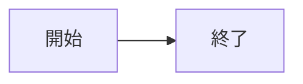

# D2フェンス：正常系サンプル

本文をViMarkdownのページへ貼り付け、Escでリッチ表示へ戻してください。
各図がNeutral Greyで描画され、日本語が欠けずに読めることを確認します。
Markdown／docx出力でも各フェンスがPNGになります。

## 1. 日本語のフロー

```d2
direction: right
編集: ノートを編集
保存: SQLiteに保存
表示: リッチ表示
編集 -> 保存: 保存する
保存 -> 表示: 表示を更新
```

## 2. 分岐と図形

```d2
direction: down
開始: 開始 {shape: oval}
確認: 入力は有効か {shape: diamond}
完了: 保存完了 {shape: oval}
再編集: 入力を修正
開始 -> 確認
確認 -> 完了: はい
確認 -> 再編集: いいえ
再編集 -> 確認
```

## 3. グループとデータベース

```d2
direction: right
アプリ: ViMarkdown {
  エディタ: Markdown編集
  レンダラー: D2描画
  エディタ -> レンダラー: 図のコード
}
DB: ノートと画像 {shape: cylinder}
アプリ.エディタ -> DB: 保存
```

## 4. 通常・太字・斜体

斜体指定はRegularで代用します。太字はBoldです。

```d2
direction: down
通常: 日本語 English 123
太字: 日本語 English 123 {style.bold: true}
斜体: 日本語 English 123 {style.italic: true}
通常 -> 太字 -> 斜体
```

## 5. 長い文字列と特殊文字

```d2
direction: down
長文: "日本語の長い説明が図形からはみ出さずに読めることを確認します ABC 0123456789"
記号: "括弧（日本語）・句読点、。・引用符\"・半角記号 # @ : /"
長文 -> 記号: "https://example.invalid はただのラベル"
```

## 6. Markdownラベル

```d2
説明: |md
  # 図の説明
  **太字の本文**

  - 日本語の項目
  - English item
|
```

## 7. コメントやラベル内の予約語

コメント・ラベル内の単語は複数図定義やimportとして扱いません。

```d2
# layers scenarios steps @import https://example.invalid
説明: "layers / scenarios / steps / @import"
補足: "URL文字列 https://example.invalid は通信を発生させません"
説明 -> 補足
```

## 8. チルダフェンスと大文字の言語指定

~~~D2
最初: チルダフェンス
最後: 大文字D2
最初 -> 最後
~~~

## 9. 同じ図の再利用

以下の2フェンスは同じコードです。両方が表示・出力されることを確認します。

```d2
開始 -> 終了
```

```d2
開始 -> 終了
```

## 10. 他の言語は図にしない

以下は通常のコード表示です。

```text
開始 -> 終了
```


